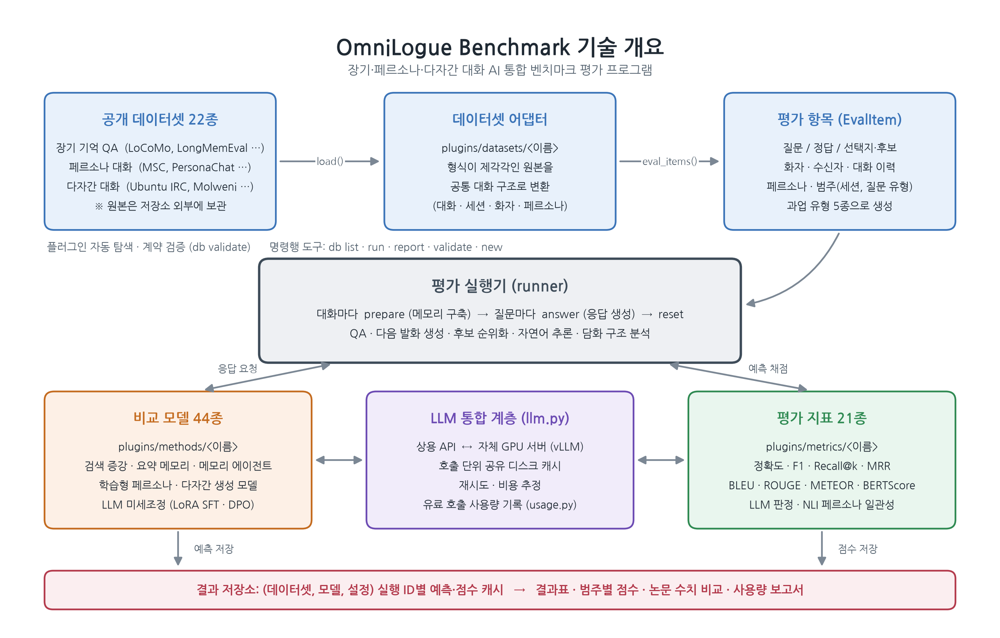

# OmniLogue Benchmark

OmniLogue Benchmark is a plugin-based benchmark harness for comparing dialogue AI systems under the same conditions. It covers LLM chatbots and memory agents along three axes:

- **Long-term memory:** remembering multi-session conversations that span months.
- **Persona consistency:** reflecting a user's or speaker's persona consistently.
- **Multi-party dialogue:** understanding conversations with three or more participants and generating responses in them.

Datasets, baselines ("methods") and metrics are each written as plugins. The engine discovers them automatically, so adding one never requires changing the engine. One command, `db run`, evaluates any dataset × method × metric combination. Results are cached per run configuration.

> 한국어 요약: 장기 대화 기억, 페르소나 일관성, 다자간 대화 능력을 같은 조건에서 비교 평가하는 플러그인 기반 통합 벤치마크입니다. 데이터셋 22종, 비교 모델 44종, 평가 지표 21종의 어댑터·구현을 포함하고, 명령 한 줄로 평가합니다.



## What's included

| | Count | Examples |
|---|---|---|
| Dataset adapters | 22 | LoCoMo, LongMemEval, MSC, PersonaChat, Conversation Chronicles, Ubuntu IRC, Molweni, MPCHAT, … |
| Methods (baselines) | 44 | full context, BM25 / dense RAG, Mem0, Zep, A-Mem, MemoryOS, HippoRAG, GraphRAG, LD-Agent, PAL, SS-MPC, EMMDG, LoRA SFT of open LLMs, … |
| Metrics | 21 | EM / F1, LLM judge, Recall@k, MRR, BLEU-1~4, ROUGE-L, METEOR, BERTScore, Distinct-n, NLI-based persona C-score, … |

The harness handles five task types: QA, next-utterance generation, candidate ranking, NLI and discourse parsing.

**Not included in this repository:**

- **Dataset files.** Each adapter's `plugins/datasets/<name>/meta.json` gives the source URL and license. Download the raw files into `data/raw/<name>/`.
- **Third-party code that some baselines run.** The engine and the plugin code are ours, but some methods call their original authors' implementation. The method docstrings call this `vendor/` code, and `NOTICE.md` lists it. Several upstream repositories carry no license, so this repository does not redistribute any of it. To run such a method, clone the upstream repository listed in `NOTICE.md` into that method's `vendor/` folder. The same applies to the upstream training code under `bob/`, `lmedr/`, `orig/` and `paa/`.

## Install

Requires Python 3.9 or newer. Development and testing used Python 3.13 on Ubuntu 24.04.

```bash
git clone https://github.com/yoonjinjang98-lab/OmniLogue-Benchmark.git && cd OmniLogue-Benchmark
python -m venv .venv
.venv/bin/pip install -e '.[dev,llm]'           # core + API clients
.venv/bin/pip install -e '.[sft,ld_agent]'      # optional: extras per baseline (see pyproject.toml)
```

API keys go in a `.env` file at the repository root, which is git-ignored. `llm.py` loads it on import.

```
OPENAI_API_KEY=...
ANTHROPIC_API_KEY=...                            # optional
DIALOGUE_BENCHMARKS_VLLM_HOST=http://<host>      # optional: your vLLM server for open models
DIALOGUE_BENCHMARKS_DATA=/path/to/data           # optional: default is ./data
```

## Usage

```bash
.venv/bin/db list                         # datasets / methods / metrics and their status
.venv/bin/db validate                     # check every plugin against its contract
.venv/bin/db run --dataset locomo --methods smoke_test --limit 5           # quick smoke test
.venv/bin/db run --dataset msc_longterm --methods ld_agent,persona_prompt --model gpt-4o-mini
.venv/bin/db run --dataset ubuntu_irc_gen --methods llm_sft --compare-paper  # diff against paper numbers
.venv/bin/db report                       # dataset × method coverage matrix
.venv/bin/python -m pytest                # tests
```

- **`--limit`** is a disposable smoke test, and its results are never stored.
- **Full runs** are stored under `data/results/<dataset>/<variant>/<method>/<run_id>/`. Re-running a stored configuration costs nothing.
- **Cost tracking.** Every paid API call is logged to `data/usage/<YYYY-MM>.jsonl`. `scripts/usage_report.py` turns that log into a per-model / per-experiment HTML report.

## Extending

```bash
.venv/bin/db new dataset|method|metric <name>    # scaffold from templates/
```

Each plugin type has one small contract, defined in `src/dialogue_benchmarks/contracts.py`:

- **Adapter:** `load(raw_dir) -> list[Conversation]`, plus an optional `eval_items(conversation)`.
- **Method:** a class with `prepare(conversation)`, `answer(item)` and `reset()`.
- **Metric:** `score(item, prediction)`, plus an optional `aggregate(...)`.

All LLM calls go through `dialogue_benchmarks.llm.complete()` and `embed()`. That one layer handles the shared cache, retries, cost tracking, and routing between commercial APIs and a self-hosted vLLM server.

Training scripts for the trainable generation baselines are described in `docs/generation_baselines.md`. These are LoRA SFT, PAL (SFT + DPO), SS-MPC, EMMDG and the NLI classifier for the C-score.

## License

The code in this repository is released under the [Apache License 2.0](LICENSE).
Third-party components that are referenced but not included, and the dataset licenses, are listed in [NOTICE.md](NOTICE.md). Some datasets are research-only or non-commercial, for example ComperDial (CC-BY-NC-SA 4.0). Check each `meta.json` before use.
